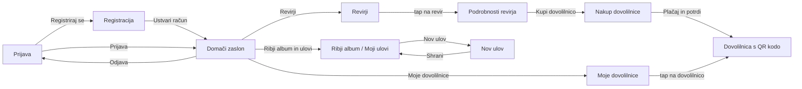
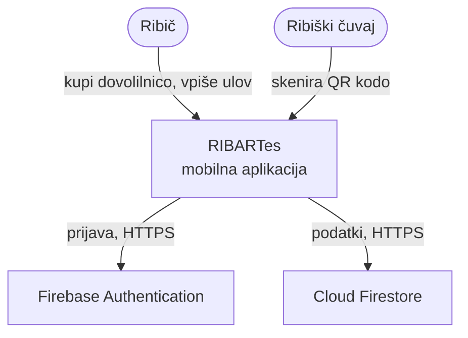
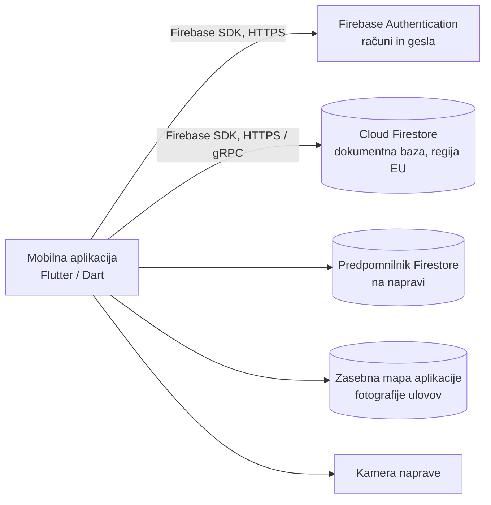
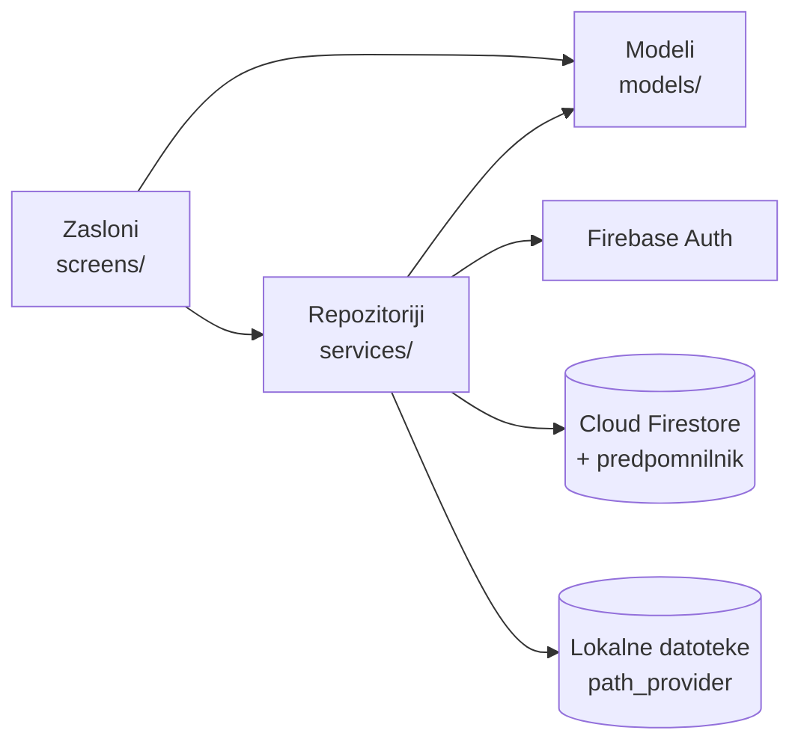
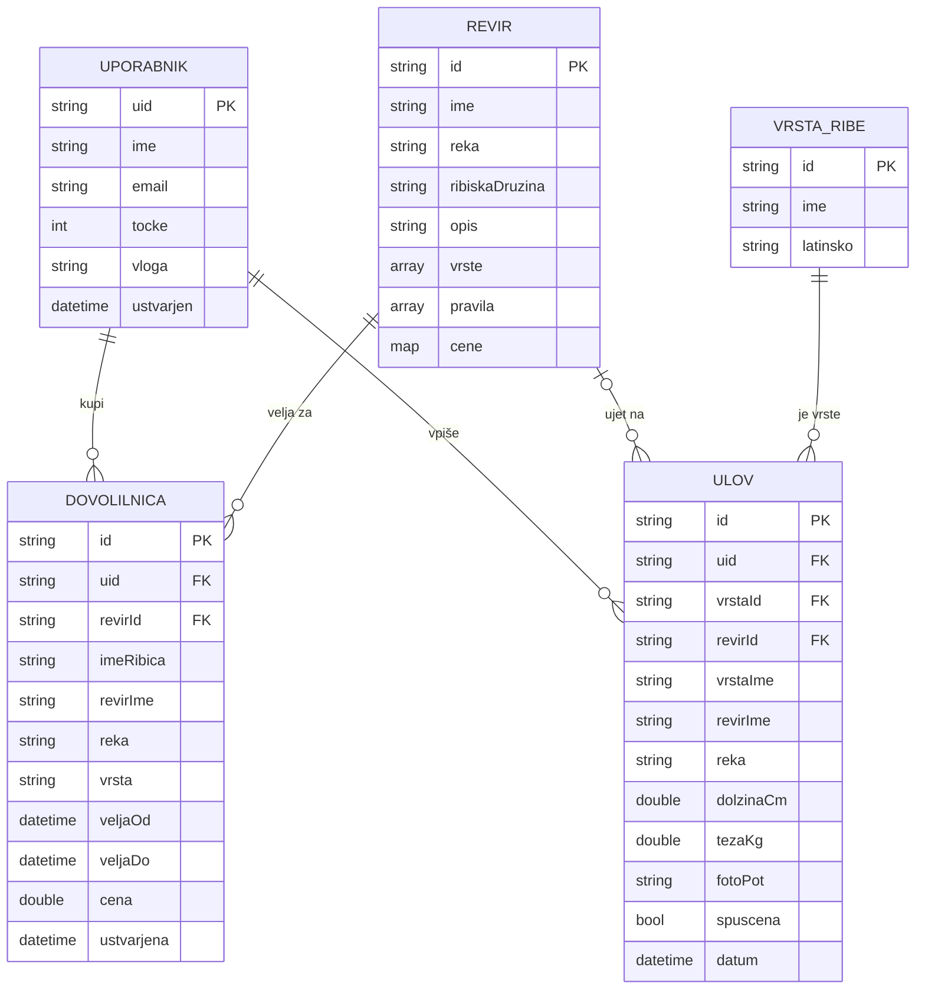
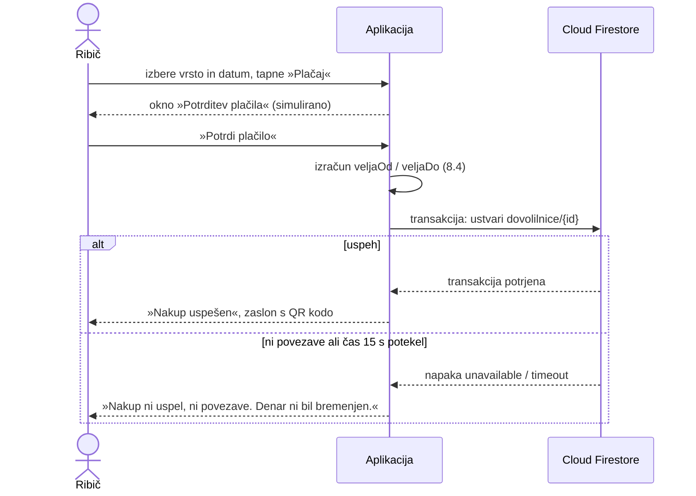
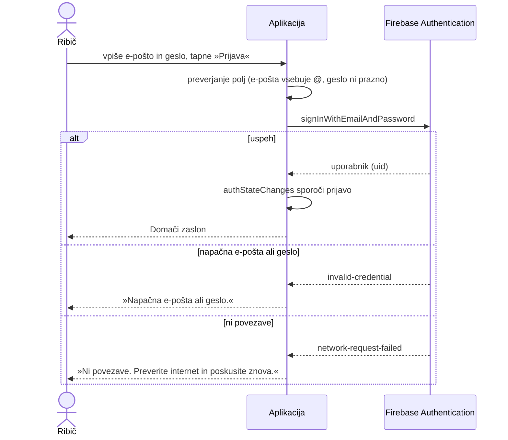
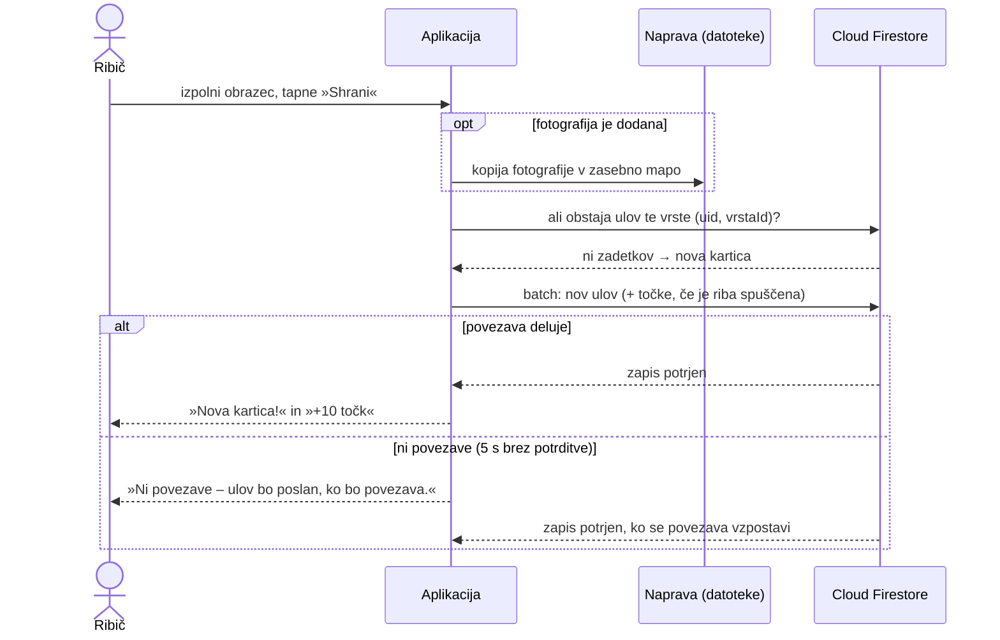
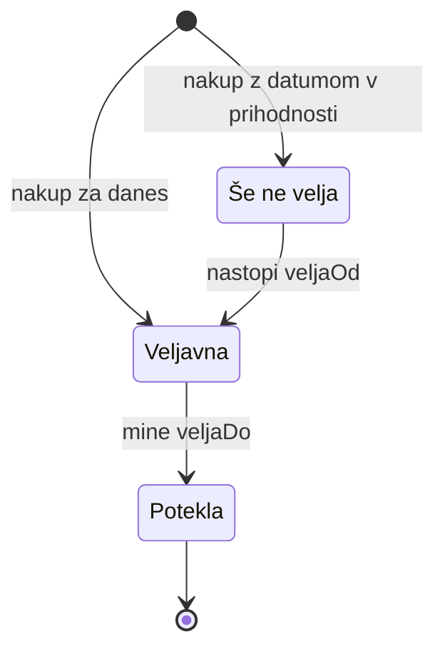

# RIBARTes – Lovim, torej sem: funkcionalna specifikacija

| | |
|---|---|
| **Člani** | Karin Majcen (63240198) |
| **Repozitorij** | https://github.com/KarinMajcen/ribartes |
| **Platforma in orodja** | Android in iOS, Flutter (Dart), Firebase Authentication, Cloud Firestore |
| **Različica dokumenta** | 0.2, 25. 11. 2026 |

---

## 1. Uvod

### 1.1 Namen

Rekreativni ribič mora danes ribolovno dovolilnico kupiti pri ribiški družini ali na prodajnem mestu, jo nositi s seboj na papirju in ulov ročno vpisovati v dnevnik. RIBARTes združi nakup dovolilnice, elektronsko dovolilnico s QR kodo in dnevnik ulova v eno mobilno aplikacijo. Ribič tako dovolilnico kupi kadarkoli, tudi ob 5. uri zjutraj ob reki, čuvaj pa njeno veljavnost preveri s skeniranjem QR kode.

### 1.2 Uporabniki

| Vloga | Opis |
|---|---|
| Ribič | Rekreativni ribič, ki želi hitro kupiti dovolilnico za izbrani revir in beležiti svoj ulov. |
| Ribiški čuvaj | Nadzornik na revirju, ki želi na kraju preveriti, ali ima ribič veljavno dovolilnico. |
| Gostilna (partner) | Gostilna ob reki, ki ribičem ponudi pripravo njihovega ulova. V tej različici le kot podatek v aplikaciji (glej Could). |

### 1.3 Obseg

**Aplikacija omogoča:**

- registracijo in prijavo ribiča z e-pošto in geslom,
- pregled revirjev z vrstami rib, pravili in cenami ter iskanje po reki in vrsti ribe,
- nakup dnevne, tedenske ali letne dovolilnice s simuliranim plačilom,
- prikaz kupljenih dovolilnic s QR kodo in stanjem veljavnosti, tudi brez povezave,
- vpis ulova (vrsta, revir, dolžina, teža, fotografija), tudi brez povezave, in ribji album, v katerem se kartica vrste odklene ob prvem ulovu,
- zbiranje točk za ribe, vrnjene v reko, in njihovo unovčenje kot popust pri dovolilnici,
- preverjanje veljavnosti dovolilnice s skeniranjem QR kode (vloga čuvaj).

**Izven obsega** (v tej različici aplikacija tega ne dela):

- pravega plačila s kartico ali drugim plačilnim sredstvom; plačilo je simulirano,
- urejanja revirjev, cen in pravil s strani ribiških družin; podatki so vneseni neposredno v bazo,
- prenosa fotografij ulova v oblak; fotografije ostanejo na napravi, kjer so bile posnete,
- ločene aplikacije za gostilne in upravljanja rezervacij s strani gostiln,
- izplačila nagrad sponzorjev.

### 1.4 Slovar pojmov

| Pojem | Pomen v tej aplikaciji |
|---|---|
| Revir | Odsek reke ali jezera, ki ga upravlja ribiška družina in za katerega se kupi dovolilnica. |
| Dovolilnica | Dovoljenje za ribolov na enem revirju za določeno obdobje (dnevna, tedenska, letna). |
| Veljavnost | Obdobje od `veljaOd` do `veljaDo`, v katerem dovolilnica velja (pravilo v 8.4). |
| Ulov | Zapis o ujeti ribi: vrsta, dolžina, teža, fotografija, revir, datum, ali je bila vrnjena v reko. |
| Ribji album | Zbirka kartic vseh vrst rib. Kartica je zaklenjena, dokler ribič te vrste ne ujame prvič. |
| Ujemi in spusti | Riba, ki jo ribič po ulovu vrne v reko. Zanjo prejme točke. |
| Točke | Nagrada za ujemi in spusti, ki jo ribič unovči kot popust pri nakupu dovolilnice. |
| Čuvaj | Ribiški nadzornik, ki preverja dovolilnice na revirju. V bazi ima uporabnik polje `vloga = "cuvaj"`. |

---

## 2. Funkcionalne zahteve

**Prioritete (MoSCoW):** **Must**: brez tega aplikacija nima smisla, mora delovati na zagovoru. **Should**: pomembno, naredim, če je le mogoče. **Could**: dobrodošlo, če ostane čas. **Won't**: zavestno izpuščeno.

### US-01: Registracija

**Kot** ribič **želim** ustvariti račun z e-pošto in geslom, **da** so moje dovolilnice in ulovi shranjeni pod mojim imenom in dostopni z vsake naprave.

**Prioriteta:** Must

```gherkin
Scenario: uspešna registracija
  Given ribič je na zaslonu »Registracija«
  And vnese ime »Janez Novak«, e-pošto »janez@primer.si« in geslo »ribolov123«
  When tapne »Ustvari račun«
  Then račun se ustvari
  And odpre se »Domači zaslon« s pozdravom »Pozdravljen, Janez«

Scenario: e-pošta je že v uporabi
  Given račun z e-pošto »janez@primer.si« že obstaja
  And ribič je na zaslonu »Registracija«
  When vnese e-pošto »janez@primer.si« in tapne »Ustvari račun«
  Then račun se ne ustvari
  And izpiše se »Račun s to e-pošto že obstaja.«

Scenario: prekratko geslo
  Given ribič je na zaslonu »Registracija«
  When vnese geslo »abc« in tapne »Ustvari račun«
  Then račun se ne ustvari
  And izpiše se »Geslo mora imeti vsaj 6 znakov.«
```

### US-02: Prijava in odjava

**Kot** ribič **želim** se prijaviti v svoj račun in se iz njega odjaviti, **da** do mojih dovolilnic ne more dostopati nihče drug.

**Prioriteta:** Must

```gherkin
Scenario: uspešna prijava
  Given ribič ima račun z e-pošto »janez@primer.si«
  And je na zaslonu »Prijava«
  When vnese pravilno e-pošto in geslo ter tapne »Prijava«
  Then odpre se »Domači zaslon«

Scenario: napačno geslo
  Given ribič je na zaslonu »Prijava«
  When vnese napačno geslo in tapne »Prijava«
  Then ostane na zaslonu »Prijava«
  And izpiše se »Napačna e-pošta ali geslo.«

Scenario: ni internetne povezave
  Given naprava nima internetne povezave
  When ribič tapne »Prijava«
  Then izpiše se »Ni povezave. Preverite internet in poskusite znova.«

Scenario: ostane prijavljen
  Given ribič se je prijavil in zaprl aplikacijo
  When aplikacijo ponovno odpre
  Then takoj se odpre »Domači zaslon« brez ponovne prijave
```

### US-03: Pregled in iskanje revirjev

**Kot** ribič **želim** videti seznam revirjev in ga filtrirati po reki in vrsti ribe, **da** hitro najdem revir, kjer lahko lovim ribo, ki me zanima.

**Prioriteta:** Must

```gherkin
Scenario: prikaz seznama
  Given v bazi je 5 revirjev
  When ribič odpre zaslon »Revirji«
  Then prikaže se 5 revirjev z imenom, reko in ceno dnevne dovolilnice

Scenario: iskanje po vrsti ribe
  Given ribič je na zaslonu »Revirji«
  When v iskalno polje vpiše »lipan«
  Then prikažejo se samo revirji, v katerih živi lipan

Scenario: ni zadetkov
  Given ribič je na zaslonu »Revirji«
  When v iskalno polje vpiše »morski pes«
  Then izpiše se »Ni revirjev, ki ustrezajo iskanju.«
```

### US-04: Podrobnosti revirja

**Kot** ribič **želim** videti podrobnosti revirja (vrste rib, pravila, cene), **da** se pred nakupom prepričam, da revir ustreza mojemu načinu ribolova.

**Prioriteta:** Must

```gherkin
Scenario: prikaz podrobnosti
  Given ribič je na zaslonu »Revirji«
  When tapne revir »Soča – Tolmin«
  Then prikažejo se vrste rib, pravila revirja in cene dnevne, tedenske in letne dovolilnice
  And prikaže se gumb »Kupi dovolilnico«

Scenario: sprememba cene v bazi
  Given ribič ima odprte podrobnosti revirja »Soča – Tolmin«
  When ribiška družina v bazi spremeni ceno dnevne dovolilnice
  Then na seznamu revirjev se prikaže nova cena brez ponovnega zagona aplikacije
```

### US-05: Nakup dovolilnice

**Kot** ribič **želim** za izbrani revir kupiti dnevno, tedensko ali letno dovolilnico za izbrani datum, **da** lahko ribarim zakonito, ne da bi moral na prodajno mesto.

**Prioriteta:** Must

```gherkin
Scenario: uspešen nakup dnevne dovolilnice
  Given ribič je na podrobnostih revirja »Soča – Tolmin«
  When izbere vrsto »dnevna« in datum »28. 11. 2026«
  And tapne »Plačaj« in potrdi simulirano plačilo
  Then dovolilnica se shrani z veljavnostjo od 28. 11. 2026 00:00 do 28. 11. 2026 23:59
  And odpre se zaslon z QR kodo nove dovolilnice

Scenario: datum v preteklosti
  Given ribič je na zaslonu »Nakup dovolilnice«
  When odpre izbiro datuma
  Then preteklih dni ni mogoče izbrati

Scenario: ni povezave ob plačilu
  Given naprava nima internetne povezave
  When ribič tapne »Plačaj« in potrdi plačilo
  Then dovolilnica se ne ustvari
  And izpiše se »Nakup ni uspel, ni povezave. Denar ni bil bremenjen.«
```

### US-06: Moje dovolilnice s QR kodo

**Kot** ribič **želim** videti svoje dovolilnice s QR kodo in stanjem veljavnosti, **da** jo lahko pokažem čuvaju na revirju.

**Prioriteta:** Must

```gherkin
Scenario: prikaz veljavne dovolilnice
  Given ribič ima dovolilnico z veljavnostjo, ki vključuje današnji dan
  When odpre »Moje dovolilnice«
  Then dovolilnica je pod »Aktivne« z oznako »Veljavna«
  And ob tapu se prikaže njena QR koda

Scenario: potekla dovolilnica
  Given ribič ima dovolilnico, ki je potekla včeraj
  When odpre »Moje dovolilnice«
  Then dovolilnica je prikazana pod »Zgodovina« z oznako »Potekla«

Scenario: brez povezave
  Given ribič je dovolilnice že enkrat odprl z internetno povezavo
  And naprava zdaj nima povezave
  When odpre »Moje dovolilnice«
  Then prikažejo se zadnje naložene dovolilnice z QR kodo
```

### US-07: Vpis ulova

**Kot** ribič **želim** vpisati ulov z vrsto, dolžino, težo in fotografijo, **da** imam pregled nad svojimi ulovi in dokaz o ujeti ribi.

**Prioriteta:** Must

```gherkin
Scenario: uspešen vpis ulova
  Given ribič je na zaslonu »Nov ulov«
  When izbere vrsto »soška postrv«, vpiše dolžino 42 cm in težo 0,9 kg
  And fotografira ribo in tapne »Shrani«
  Then ulov se shrani z današnjim datumom
  And prikaže se na zavihku »Moji ulovi«

Scenario: manjka vrsta ribe
  Given ribič je na zaslonu »Nov ulov«
  And vrsta ribe ni izbrana
  When tapne »Shrani«
  Then ulov se ne shrani
  And izpiše se »Izberite vrsto ribe.«

Scenario: zavrnjeno dovoljenje za kamero
  Given ribič na zaslonu »Nov ulov« tapne »Fotografiraj«
  When dovoljenje za kamero zavrne
  Then izpiše se »Brez dovoljenja za kamero fotografije ni mogoče dodati.«
  And ulov lahko shrani brez fotografije

Scenario: ni povezave
  Given naprava nima internetne povezave
  When ribič vpiše ulov in tapne »Shrani«
  Then ulov se takoj prikaže na zavihku »Moji ulovi«
  And izpiše se »Ni povezave – ulov bo poslan, ko bo povezava.«
```

### US-08: Ribji album

**Kot** ribič **želim** zbirko kartic vseh slovenskih vrst rib, ki se odklenejo ob prvem ulovu, **da** imam cilj in motivacijo za ribolov na različnih revirjih.

**Prioriteta:** Must

```gherkin
Scenario: odklep nove kartice
  Given ribič še ni ujel nobene soške postrvi
  When shrani ulov vrste »soška postrv«
  Then prikaže se okno »Nova kartica!«
  And v »Ribjem albumu« je kartica soške postrvi odklenjena

Scenario: prikaz napredka
  Given v bazi je 15 vrst rib
  And ribič je ujel 4 različne vrste
  When odpre »Ribji album«
  Then prikaže se »Zbranih 4 / 15«
  And 11 kartic je prikazanih kot zaklenjenih (siva kartica s ključavnico)
```

### US-09: Točke ujemi in spusti

**Kot** ribič **želim** za vsako ribo, ki jo vrnem v reko, prejeti točke, **da** sem nagrajen za trajnostni ribolov.

**Prioriteta:** Should

```gherkin
Scenario: točke za spuščeno ribo
  Given ribič ima 30 točk
  When vpiše ulov in vklopi »Vrnjena v reko«
  Then ribič ima 40 točk
  And izpiše se »+10 točk za ujemi in spusti!«

Scenario: riba ni vrnjena
  Given ribič ima 30 točk
  When vpiše ulov brez oznake »Vrnjena v reko«
  Then ribič ima še vedno 30 točk
```

### US-10: Popust s točkami

**Kot** ribič **želim** pri nakupu dovolilnice unovčiti točke kot popust, **da** imam od zbranih točk konkreten prihranek.

**Prioriteta:** Should

```gherkin
Scenario: unovčenje točk
  Given ribič ima 250 točk
  And dnevna dovolilnica stane 25,00 €
  When na zaslonu »Nakup dovolilnice« vklopi »Unovči točke«
  Then cena se zniža na 23,00 €
  And po nakupu ima ribič 50 točk

Scenario: premalo točk
  Given ribič ima 60 točk
  When odpre zaslon »Nakup dovolilnice«
  Then stikalo »Unovči točke« je onemogočeno
  And izpiše se »Za popust potrebujete vsaj 100 točk.«
```

### US-11: Preverjanje dovolilnice (čuvaj)

**Kot** ribiški čuvaj **želim** skenirati QR kodo na ribičevem telefonu, **da** takoj vidim, ali ima veljavno dovolilnico za ta revir.

**Prioriteta:** Should

```gherkin
Scenario: veljavna dovolilnica
  Given čuvaj je na zaslonu »Preveri dovolilnico«
  When skenira QR kodo dovolilnice, ki velja danes
  Then prikaže se zeleno sporočilo »Veljavna« z imenom ribiča, revirjem in datumom veljavnosti

Scenario: potekla dovolilnica
  Given čuvaj je na zaslonu »Preveri dovolilnico«
  When skenira QR kodo dovolilnice, ki je potekla
  Then prikaže se rdeče sporočilo »Ni veljavna – potekla 27. 11. 2026«

Scenario: neznana koda
  Given čuvaj je na zaslonu »Preveri dovolilnico«
  When skenira QR kodo, ki ni dovolilnica RIBARTes
  Then prikaže se »Neznana koda«
```

### US-12: Tedenska lestvica

**Kot** ribič **želim** videti lestvico največjih ulovov tega tedna po rekah, **da** se lahko primerjam z drugimi ribiči.

**Prioriteta:** Could

```gherkin
Scenario: prikaz lestvice
  Given ta teden je bilo na Soči vpisanih 8 ulovov
  When ribič odpre »Lestvica« in izbere reko »Soča«
  Then prikaže se 8 ulovov, razvrščenih po dolžini od največje do najmanjše

Scenario: ni ulovov
  Given ta teden na Krki ni bilo vpisanih ulovov
  When ribič izbere reko »Krka«
  Then izpiše se »Ta teden še ni ulovov. Bodi prvi!«
```

### US-13: Rezervacija priprave ulova v gostilni

**Kot** ribič **želim** v partnerski gostilni ob reki rezervirati pripravo svojega ulova, **da** ga lahko pojem sveže pripravljenega takoj po ribolovu.

**Prioriteta:** Could

```gherkin
Scenario: uspešna rezervacija
  Given ribič je na zaslonu »Gostilne«
  When izbere gostilno »Pri Soči«, uro 13:00 in tapne »Rezerviraj«
  Then rezervacija se shrani
  And izpiše se »Rezervacija potrjena za 13:00.«

Scenario: ura v preteklosti
  Given ura je 14:00
  When ribič izbere uro 13:00 za danes
  Then gumb »Rezerviraj« je onemogočen
```

### Won't (zavestno izpuščeno)

- Pravo plačilo (kartica, Apple Pay, Google Pay): zahteva pogodbo s plačilnim ponudnikom in varnostni pregled, kar presega obseg seminarske naloge. Plačilo je simulirano.
- Upravljanje revirjev za ribiške družine: zahteva ločeno vlogo in skrbniški vmesnik. Revirji so vneseni neposredno v bazo.
- Prenos fotografij v oblak (Firebase Storage): za nove projekte zahteva plačljivi paket. Fotografije ostanejo na napravi.
- Nagrade sponzorjev za zmagovalca tedna: zahteva dogovore s sponzorji.
- Aplikacija za gostilne (sprejem in potrjevanje rezervacij): ločena aplikacija.

---

## 3. Nefunkcionalne zahteve

Meritve zmogljivosti so izvedene na emulatorju Pixel 8 (Android, razvojna različica aplikacije) z delujočo internetno povezavo, razen kjer je navedeno drugače.

| Oznaka | Kategorija | Zahteva | Kako preverimo |
|---|---|---|---|
| NFR-01 | Zmogljivost | Seznam revirjev se prikaže v manj kot 1 s po odprtju zaslona »Revirji« (po prvem nalaganju podatkov). | Merjenje s štoparico, 5 ponovitev. |
| NFR-02 | Zmogljivost | Iskanje po revirjih posodobi seznam ob vsakem vpisanem znaku, brez vidnega zamika (iskanje poteka na napravi). | Vpis besede »lipan«, opazovanje. |
| NFR-03 | Zanesljivost | Brez povezave zaslon »Moje dovolilnice« prikaže zadnje naložene dovolilnice s QR kodo. | Letalski način, odpri zaslon. |
| NFR-04 | Zanesljivost | Nakup brez povezave ne ustvari dovolilnice; ribič v največ 15 s dobi sporočilo o neuspehu. | Letalski način, poskus nakupa, preverjanje zbirke `dovolilnice`. |
| NFR-05 | Zanesljivost | Ulov, vpisan brez povezave, se takoj prikaže v aplikaciji in se pošlje v bazo v 1 minuti po vzpostavitvi povezave. | Letalski način, vpis ulova, izklop letalskega načina, preverjanje zbirke `ulovi`. |
| NFR-06 | Varnost (MASVS-AUTH) | Aplikacija gesla ne shranjuje; prijava poteka prek Firebase Authentication. Geslo ima vsaj 6 znakov. | Pregled kode, US-01 scenarij »prekratko geslo«. |
| NFR-07 | Varnost (MASVS-AUTH) | Ribič lahko bere samo svoje dovolilnice in ulove; dovolilnico drugega ribiča lahko prebere samo uporabnik z vlogo »cuvaj«. Po nakupu dovolilnice ni mogoče spremeniti. | Varnostna pravila Firestore (`docs/firestore.rules`), preizkus v Rules Playground. |
| NFR-08 | Varnost (MASVS-AUTH) | Ribič si ne more sam dodeliti vloge »cuvaj«. | Pravilo za `uporabniki` (`vloga` se ob posodobitvi ne sme spremeniti). |
| NFR-09 | Varnost (MASVS-NETWORK) | Vsa komunikacija s Firebase poteka prek šifrirane povezave (HTTPS/TLS), ki jo zagotavlja Firebase SDK. | Dokumentacija Firebase. |
| NFR-10 | Varnost (MASVS-STORAGE) | Fotografije ulova so shranjene v zasebni mapi aplikacije, do katere druge aplikacije nimajo dostopa. | Pregled kode (`getApplicationDocumentsDirectory`). |
| NFR-11 | Zasebnost (MASVS-PRIVACY) | Podatki v Firestore so shranjeni v regiji EU. | Firebase konzola, nastavitve baze. |
| NFR-12 | Dostopnost | Vsi glavni gumbi so visoki vsaj 48 dp; ikone brez besedila imajo opis (tooltip) za bralnik zaslona. | Pregled zaslonov, TalkBack. |
| NFR-13 | Združljivost | Aplikacija deluje na Androidu z najnižjo različico, določeno z `minSdk` v `android/app/build.gradle.kts`. | Zagon na emulatorju z najnižjo podprto različico. |

**Znana omejitev:** točke za ujemi in spusti izračuna aplikacija na napravi. Spreten uporabnik bi jih lahko ponaredil. V produkcijski različici bi točke prištel strežnik (npr. Cloud Functions), ki bi tudi preveril ulov.

### 3.1 Osebni podatki in dovoljenja

| Podatek ali dovoljenje | Zakaj ga potrebujemo | Kdaj ga zahtevamo | Kje je shranjen |
|---|---|---|---|
| Ime in priimek | Prikaz na dovolilnici, da čuvaj preveri ribiča. | Ob registraciji. | Firebase Authentication in Firestore (`uporabniki`), EU. |
| E-pošta | Prijava v račun. | Ob registraciji. | Firebase Authentication in Firestore (`uporabniki`), EU. |
| Geslo | Prijava v račun. | Ob registraciji. | Samo Firebase Authentication (zgoščeno); aplikacija ga ne hrani. |
| Dovolilnice | Dokazilo o plačilu in veljavnosti. | Ob nakupu. | Firestore (`dovolilnice`), EU, in predpomnilnik na napravi. |
| Ulovi (vrsta, mere, revir, datum) | Dnevnik ulova in ribji album. | Ob vpisu ulova. | Firestore (`ulovi`), EU, in predpomnilnik na napravi. |
| Fotografija ulova | Dokaz o ulovu, prikaz v seznamu. | Ob tapu »Fotografiraj« ali »Iz galerije«. | Samo na napravi, v zasebni mapi aplikacije. |
| Dovoljenje CAMERA | Fotografiranje ulova (US-07), skeniranje QR kode (US-11). | Šele ob tapu »Fotografiraj« oziroma ob odprtju skenerja, ne ob zagonu. | – |
| Dostop do galerije | Izbira obstoječe fotografije. | Ob tapu »Iz galerije« (sistemski izbirnik fotografij, brez posebnega dovoljenja). | – |

Aplikacija ne zbira lokacije. Če ribič dovoljenje za kamero zavrne, lahko ulov shrani brez fotografije (US-07).

---

## 4. Uporabniški vmesnik

### 4.1 Tok zaslonov



### 4.2 Zasloni

Zasloni upoštevajo smernice Material Design 3 (privzete komponente Flutterja). Slike so posnetki zaslona z emulatorja.

#### Prijava


Ribič vpiše e-pošto in geslo. Napaka se izpiše pod obrazcem. Povezava vodi na registracijo. **Pokriva:** US-02

#### Registracija


Ime in priimek, e-pošta in geslo (vsaj 6 znakov). **Pokriva:** US-01

#### Domači zaslon


Pozdrav z imenom, stanje točk, vstop v Revirje, Moje dovolilnice in Ribji album. Gumb za odjavo v zgornji vrstici. **Pokriva:** US-02, US-09

#### Revirji


Iskalno polje in seznam revirjev z reko, vrstami rib in ceno dnevne dovolilnice. **Pokriva:** US-03

#### Podrobnosti revirja


Opis, vrste rib, pravila in cene vseh treh vrst dovolilnic ter gumb »Kupi dovolilnico«. **Pokriva:** US-04

#### Nakup dovolilnice


Izbira vrste (dnevna, tedenska, letna) in datuma začetka, povzetek veljavnosti in cene, gumb »Plačaj« s potrditvijo simuliranega plačila. **Pokriva:** US-05 (US-10)

#### Dovolilnica s QR kodo


Oznaka stanja (Veljavna, Še ne velja, Potekla), QR koda na belem ozadju, ime ribiča, obdobje veljavnosti in plačani znesek. **Pokriva:** US-06

#### Moje dovolilnice


Aktivne dovolilnice (veljavne in prihodnje) zgoraj, potekle pod »Zgodovina«. **Pokriva:** US-06

#### Nov ulov


Vrsta ribe (obvezno), revir, dolžina (obvezno), teža, fotografija (kamera ali galerija) in stikalo »Vrnjena v reko«. **Pokriva:** US-07, US-09

#### Ribji album in Moji ulovi


Zavihek Album: napredek »Zbranih X / 15« in mreža kartic, odklenjene so obarvane. Zavihek Moji ulovi: seznam ulovov s sličico fotografije. **Pokriva:** US-07, US-08

---

## 5. Arhitektura

### 5.1 Kontekst (C4, raven 1)



### 5.2 Vsebniki (C4, raven 2)

Aplikacija nima lastnega strežnika. Kot zaledje uporablja storitvi Firebase (Backend as a Service).



### 5.3 Plasti aplikacije

Koda v mapi `app/lib` je razdeljena na plasti po Googlovi priporočeni arhitekturi:

- **Zasloni** (`screens/`): Flutter widgeti. Stanje zaslona (vnosna polja, nalaganje, napake) hranijo `StatefulWidget`-i, podatke iz baze pa prikazujejo prek `StreamBuilder`, ki zaslon samodejno osveži ob vsaki spremembi v bazi. Ta del opravlja vlogo plasti ViewModel.
- **Repozitoriji** (`services/`): `AuthService`, `RevirService`, `DovolilnicaService`, `UlovService`. Zasloni Firebase nikoli ne kličejo neposredno, ampak samo metode teh razredov. Repozitoriji tudi prevedejo napake Firebase v sporočila za uporabnika.
- **Modeli** (`models/`): `Revir`, `Dovolilnica`, `Ulov`, `VrstaRibe`. Vsebujejo pretvorbo iz dokumenta Firestore in poslovna pravila (veljavnost, stanje dovolilnice, iskanje).
- **Viri podatkov:** Firebase Authentication, Cloud Firestore s predpomnilnikom na napravi in lokalne datoteke (fotografije).



Uporabljene knjižnice: `firebase_core`, `firebase_auth`, `cloud_firestore`, `qr_flutter` (izris QR kode), `mobile_scanner` (skener, US-11), `image_picker` (kamera, galerija), `path_provider` (lokalna mapa), `intl` (oblikovanje cen).

---

## 6. Podatkovni model

Podatki so v dokumentni bazi Cloud Firestore. Vsaka entiteta je zbirka, vsak zapis dokument. Povezave so izvedene z ID-ji (npr. `dovolilnica.uid` kaže na uporabnika). Nekateri podatki so namenoma podvojeni (npr. `revirIme` v dovolilnici), da se dovolilnica prikaže brez dodatnega branja revirja in da ostane pravilna, tudi če se revir kasneje preimenuje.



### Uporabnik (`uporabniki/{uid}`)

| Atribut | Tip | Obvezen | Opis |
|---|---|---|---|
| uid | string | da | ID dokumenta, enak ID-ju v Firebase Authentication. |
| ime | string | da | Ime in priimek. |
| email | string | da | E-poštni naslov. |
| tocke | number | da | Točke ujemi in spusti, začetna vrednost 0. |
| vloga | string | da | `ribic` ali `cuvaj`. Ob registraciji vedno `ribic`. |
| ustvarjen | timestamp | da | Čas registracije (strežnik). |

### Revir (`revirji/{id}`)

| Atribut | Tip | Obvezen | Opis |
|---|---|---|---|
| id | string | da | ID dokumenta, npr. `soca-tolmin`. |
| ime | string | da | Npr. »Soča – Tolmin«. |
| reka | string | da | Ime reke. |
| ribiskaDruzina | string | da | Upravljavec revirja. |
| opis | string | ne | Kratek opis. |
| vrste | array<string> | da | Imena vrst rib v revirju. |
| pravila | array<string> | ne | Pravila ribolova. |
| cene | map | da | `dnevna`, `tedenska`, `letna` v evrih, > 0. |

### Dovolilnica (`dovolilnice/{id}`)

| Atribut | Tip | Obvezen | Opis |
|---|---|---|---|
| id | string | da | Naključni ID; vsebina QR kode je `RIBARTES:{id}`. |
| uid | string | da | Lastnik (ribič). |
| imeRibica | string | da | Ime ob nakupu, za čuvaja. |
| revirId, revirIme, reka | string | da | Revir, za katerega velja. |
| vrsta | string | da | `dnevna`, `tedenska` ali `letna`. |
| veljaOd, veljaDo | timestamp | da | Obdobje veljavnosti (pravilo v 8.4). `veljaDo` > `veljaOd`. |
| cena | number | da | Plačani znesek v evrih. |
| ustvarjena | timestamp | da | Čas nakupa (strežnik). |

### Ulov (`ulovi/{id}`)

| Atribut | Tip | Obvezen | Opis |
|---|---|---|---|
| id | string | da | Naključni ID. |
| uid | string | da | Ribič. |
| vrstaId, vrstaIme | string | da | Vrsta ribe. |
| revirId, revirIme, reka | string | ne | Revir ulova. |
| dolzinaCm | number | da | Dolžina v cm, od 1 do 300. |
| tezaKg | number | ne | Teža v kg, od 0 do 150. |
| fotoPot | string | ne | Pot do fotografije na napravi. |
| spuscena | bool | da | Ali je bila riba vrnjena v reko. |
| datum | timestamp | da | Čas vpisa (čas naprave, da obstaja tudi brez povezave). |

### Vrsta ribe (`vrste_rib/{id}`)

| Atribut | Tip | Obvezen | Opis |
|---|---|---|---|
| id | string | da | Npr. `soska-postrv`. |
| ime | string | da | Slovensko ime. |
| latinsko | string | da | Latinsko ime. |

**Hramba:** glavni vir podatkov je Cloud Firestore (regija EU). Firestore samodejno hrani kopijo prebranih podatkov na napravi, zato so seznami in QR kode na voljo tudi brez povezave. Zapisi ulovov brez povezave se shranijo na napravo in se pošljejo, ko je povezava; ob konfliktu velja zadnji zapis na strežniku. Nakup dovolilnice je transakcija, ki brez povezave ne uspe (glej 8.1). Fotografije so samo na napravi, kjer so bile posnete.

---

## 7. Zunanji vmesniki

Aplikacija do Firebase dostopa prek uradnega Firebase SDK za Flutter, ki komunicira s strežniki prek HTTPS. Spodaj so opisani klici, ki jih aplikacija uporablja.

### 7.1 Firebase Authentication

| | |
|---|---|
| **Namen** | Registracija, prijava, odjava in pomnjenje prijave. |
| **Dokumentacija** | https://firebase.google.com/docs/auth/flutter/password-auth |
| **Avtentikacija** | API ključ projekta (v `lib/firebase_options.dart`), ni skrivnost. |
| **Omejitve** | Ob prevelikem številu neuspešnih prijav Firebase začasno blokira poskuse (`too-many-requests`). |

**Zahteva (registracija):**

```dart
FirebaseAuth.instance.createUserWithEmailAndPassword(
  email: 'janez@primer.si', password: 'ribolov123');
```

**Odgovor** (polja, ki jih uporabljamo):

```json
{ "user": { "uid": "Xk3…", "email": "janez@primer.si", "displayName": "Janez Novak" } }
```

**Napake:** koda napake se prevede v sporočilo za uporabnika: `email-already-in-use` → »Račun s to e-pošto že obstaja.«, `weak-password` → »Geslo mora imeti vsaj 6 znakov.«, `invalid-credential` → »Napačna e-pošta ali geslo.«, `network-request-failed` → »Ni povezave. Preverite internet in poskusite znova.«, `too-many-requests` → »Preveč poskusov. Poskusite znova čez nekaj minut.«

### 7.2 Cloud Firestore

| | |
|---|---|
| **Namen** | Branje revirjev in vrst rib, shranjevanje dovolilnic, ulovov in profila. |
| **Dokumentacija** | https://firebase.google.com/docs/firestore |
| **Avtentikacija** | Prijavljeni uporabnik (Firebase Authentication); dostop omejujejo varnostna pravila (`docs/firestore.rules`). |
| **Omejitve** | Brezplačni paket Spark: 50 000 branj in 20 000 zapisov na dan. |

**Zahteve, ki jih aplikacija uporablja:**

| Operacija | Klic | Zgodba |
|---|---|---|
| Seznam revirjev (v živo) | `revirji.orderBy('ime').snapshots()` | US-03 |
| Moje dovolilnice (v živo) | `dovolilnice.where('uid', isEqualTo: uid).snapshots()` | US-06 |
| Nakup | `runTransaction(tx.set(dovolilnice/{nov id}, …))` | US-05 |
| Ali že imam to vrsto | `ulovi.where('uid', ==).where('vrstaId', ==).limit(1).get()` | US-08 |
| Vpis ulova in točke | `batch.set(ulovi/{nov id})` + `batch.set(uporabniki/{uid}, {tocke: increment(10)}, merge)` | US-07, US-09 |

**Primer dokumenta (dovolilnica):**

```json
{
  "uid": "Xk3…",
  "imeRibica": "Janez Novak",
  "revirId": "soca-tolmin",
  "revirIme": "Soča – Tolmin",
  "reka": "Soča",
  "vrsta": "dnevna",
  "veljaOd": "2026-11-28T00:00:00+01:00",
  "veljaDo": "2026-11-28T23:59:59+01:00",
  "cena": 65,
  "ustvarjena": "2026-11-25T10:12:00+01:00"
}
```

**Napake:** `unavailable` (ni povezave) pri nakupu → »Nakup ni uspel, ni povezave. Denar ni bil bremenjen.«; branje brez povezave vrne podatke iz predpomnilnika; zapis ulova brez povezave se shrani lokalno in pošlje kasneje; `permission-denied` pomeni kršitev varnostnih pravil in se prikaže kot splošna napaka.

### API-ji naprave

| API | Dovoljenje | Za kaj |
|---|---|---|
| Kamera (`image_picker`) | CAMERA | Fotografiranje ulova (US-07). |
| Sistemski izbirnik fotografij (`image_picker`) | brez (Android Photo Picker) | Izbira fotografije iz galerije (US-07). |
| Datotečni sistem (`path_provider`) | brez (zasebna mapa aplikacije) | Shranjevanje fotografij ulova. |
| Kamera (`mobile_scanner`) | CAMERA | Skeniranje QR kode dovolilnice (US-11). |

---

## 8. Dinamika

### 8.1 Nakup dovolilnice



Transakcija je izbrana namenoma: navaden zapis bi Firestore brez povezave postavil v čakalno vrsto in poslal kasneje, ribič pa ne bi vedel, ali je nakup uspel.

### 8.2 Prijava uporabnika



### 8.3 Vpis ulova



### 8.4 Stanja: dovolilnica

Stanje se ne shranjuje v bazo, ampak se izračuna iz trenutnega časa ter polj `veljaOd` in `veljaDo`. Dovolilnica nastane šele po potrjenem plačilu, zato stanja »neplačana« ni.



### 8.5 Algoritem: veljavnost dovolilnice

- **Vhod:** vrsta dovolilnice (`dnevna`, `tedenska`, `letna`), izbrani datum začetka *d* (datum, ne v preteklosti).
- **Izhod:** `veljaOd`, `veljaDo` (datum in čas, lokalni čas naprave).
- **Pravilo:**
  - `veljaOd` = *d* ob 00:00:00
  - dnevna: `veljaDo` = *d* ob 23:59:59
  - tedenska: `veljaDo` = *d* + 6 dni ob 23:59:59 (skupaj 7 koledarskih dni)
  - letna: `veljaDo` = 31. 12. leta *d* ob 23:59:59
- **Robni primeri:** datum v preteklosti → nakup ni mogoč; tedenska čez konec meseca (npr. 28. 11. + 6 dni = 4. 12.) se izračuna pravilno; letna, kupljena 31. 12., velja en dan.
- **Primer:** tedenska, *d* = 28. 11. 2026 → velja od 28. 11. 2026 00:00 do 4. 12. 2026 23:59.

### 8.6 Algoritem: točke ujemi in spusti in popust

- **Vhod:** ulov z oznako `spuscena`; ob nakupu stanje točk *T* in cena dovolilnice *C* v evrih.
- **Izhod:** novo stanje točk; popust *P* v evrih in nova cena.
- **Pravilo:**
  - ulov s `spuscena = true` → *T* = *T* + 10; sicer *T* ostane enak
  - popust (US-10): *P* = min(⌊*T* / 100⌋, ⌊*C* / 2⌋) €; porabljene točke = *P* × 100; nova cena = *C* − *P*
- **Robni primeri:** *T* < 100 → popusta ni (stikalo onemogočeno); popust ne preseže polovice cene.
- **Primer:** *T* = 250, *C* = 25,00 € → *P* = min(2, 12) = 2 € → cena 23,00 €, ostane 50 točk.

### 8.7 Algoritem: odklep kartice v ribjem albumu

- **Vhod:** vrsta novega ulova, vsi dosedanji ulovi ribiča.
- **Izhod:** ali je to nova kartica; za album: število zbranih vrst ter za vsako vrsto število ulovov in največja dolžina.
- **Pravilo:** kartica je nova, če ribič pred tem ni imel nobenega ulova te vrste. Zbrane vrste = število različnih `vrstaId` med ulovi.
- **Robni primeri:** brez povezave in brez podatkov v predpomnilniku se nova kartica ne oznani (album se kljub temu pravilno posodobi, ko se ulovi naložijo).
- **Primer:** ribič ima ulove klena, lipana in 2 × soške postrvi (42 in 50 cm) → »Zbranih 3 / 15«, kartica soške postrvi »×2 · 50 cm«.

---

## 9. Sledljivost

| Zgodba | Prioriteta | Zasloni | Preverjanje | Stanje |
|---|---|---|---|---|
| US-01 Registracija | Must | Registracija | ročni test po scenarijih | narejeno |
| US-02 Prijava in odjava | Must | Prijava, Domači zaslon | ročni test po scenarijih | narejeno |
| US-03 Pregled in iskanje revirjev | Must | Revirji | ročni test po scenarijih | narejeno |
| US-04 Podrobnosti revirja | Must | Podrobnosti revirja | ročni test po scenarijih | narejeno |
| US-05 Nakup dovolilnice | Must | Nakup dovolilnice | ročni test po scenarijih, letalski način | narejeno |
| US-06 Moje dovolilnice s QR kodo | Must | Moje dovolilnice, Dovolilnica | ročni test po scenarijih, letalski način | narejeno |
| US-07 Vpis ulova | Must | Nov ulov, Moji ulovi | ročni test po scenarijih, letalski način | narejeno |
| US-08 Ribji album | Must | Ribji album | ročni test po scenarijih | narejeno |
| US-09 Točke ujemi in spusti | Should | Nov ulov, Domači zaslon | ročni test po scenarijih | narejeno |
| US-10 Popust s točkami | Should | Nakup dovolilnice | ročni test po scenarijih | načrtovano |
| US-11 Preverjanje dovolilnice | Should | Preveri dovolilnico | demonstracija na zagovoru | načrtovano |
| US-12 Tedenska lestvica | Could | Lestvica | ročni test po scenarijih | načrtovano |
| US-13 Rezervacija v gostilni | Could | Gostilne | ročni test po scenarijih | načrtovano |

---

## 10. Zgodovina sprememb

| Različica | Datum | Spremembe |
|---|---|---|
| 0.1 | 24. 11. 2026 | Prva različica: uvod, uporabniške zgodbe, sledljivost |
| 0.2 | 25. 11. 2026 | Nefunkcionalne zahteve, osebni podatki in dovoljenja, vmesnik, arhitektura, podatkovni model, zunanji vmesniki, dinamika in algoritmi; posodobljena sledljivost (US-01–US-09) |
