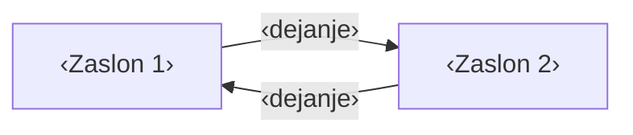
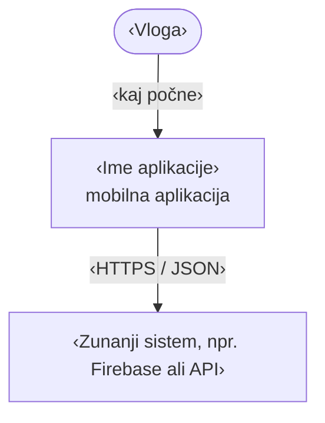
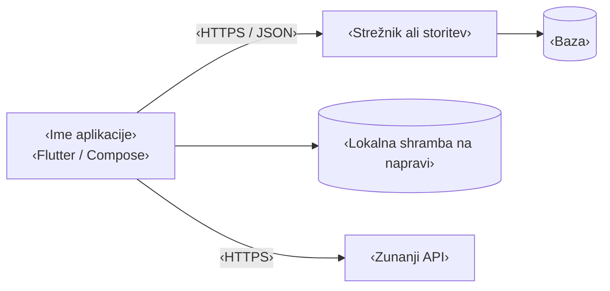
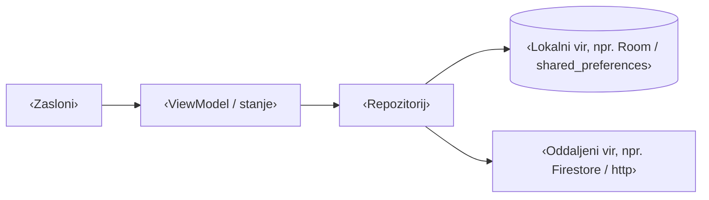
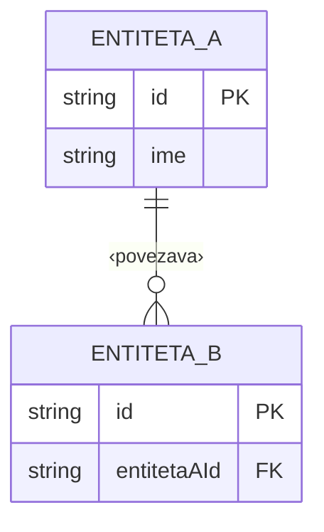
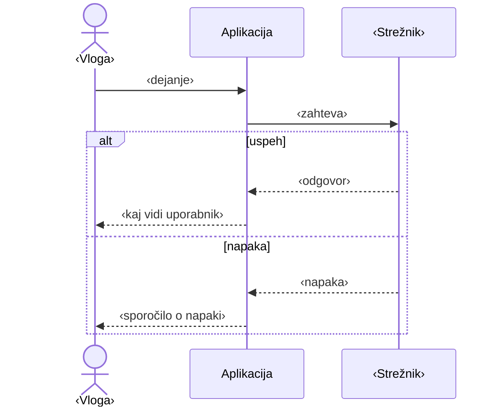
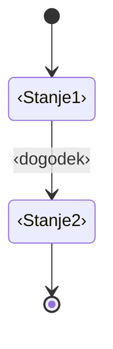

# ‹Ime aplikacije›: funkcionalna specifikacija

> **Kako uporabiti predlogo** (ta okvir pred oddajo pobrišite)
>
> - Datoteko skopirajte v svoj repozitorij kot **`docs/SPECIFIKACIJA.md`**, slike zaslonov pa v mapo **`docs/img/`**. V `README.md` dodajte povezavo nanjo.
> - Vse besedilo v znakih ‹ › zamenjajte s svojim. Diagrame pišete v Mermaidu, GitHub jih sam nariše. Urejevalnik v brskalniku: mermaid.live.
> - Dokument dopolnjujete sproti. **Rok za oddajo: dan pred vašim zagovorom.** V e-učilnico oddate PDF (npr. VS Code z razširitvijo *Markdown PDF*) in povezavo na repozitorij.
> - Opisujte **svojo** aplikacijo. Besedila, ki bi ga lahko prilepili v katerokoli specifikacijo, naj ne bo.
> - Besede, kot so *hitro, enostavno, intuitivno, uporabniku prijazno, po potrebi, itd.*, zamenjajte s številko ali primerom. Zahteva, ki je ni mogoče preveriti, ni zahteva.
> - Dokumentacija naj opisuje vašo dejansko aplikacijo. Razdelki, označeni s **(če velja)**, so obvezni le, če jih vaša aplikacija ima. Če ga nima, napišite en stavek, zakaj ne.
>
> | Razdelek | Obvezen |
> |---|---|
> | 1 Uvod, 2 Funkcionalne zahteve, 3 Nefunkcionalne zahteve, 4 Uporabniški vmesnik | da |
> | 5.1 Kontekst, 5.3 Plasti aplikacije | da |
> | 5.2 Vsebniki | če velja: aplikacija ima strežnik ali zunanje storitve |
> | 6 Podatkovni model | da, za vse podatke, ki jih aplikacija hrani |
> | 7 Zunanji vmesniki | če velja: aplikacija uporablja zunanji API ali API naprave |
> | 8.1 Sekvenčni diagram | da, vsaj en; z oddaljenimi podatki vsaj dva |
> | 8.3 Stanja, 8.4 Algoritem | če velja |
> | 9 Sledljivost, 10 Zgodovina sprememb | da |

| | |
|---|---|
| **Člani** | ‹Ime Priimek›, ‹Ime Priimek› |
| **Repozitorij** | ‹https://github.com/…› |
| **Platforma in orodja** | ‹npr. Android, Kotlin + Jetpack Compose / Android in iOS, Flutter› |
| **Različica dokumenta** | ‹0.1›, ‹datum› |

---

## 1. Uvod

### 1.1 Namen

‹Kateri problem aplikacija rešuje in za koga. Dva ali trije stavki.›

### 1.2 Uporabniki

| Vloga | Opis |
|---|---|
| ‹vloga, npr. stanovalec› | ‹kdo je to in kaj želi doseči, en stavek› |

### 1.3 Obseg

**Aplikacija omogoča:**

- ‹…›

**Izven obsega** (v tej različici aplikacija tega ne dela):

- ‹…›

### 1.4 Slovar pojmov

| Pojem | Pomen v tej aplikaciji |
|---|---|
| ‹izraz, ki ima v vaši aplikaciji poseben pomen› | ‹…› |

---

## 2. Funkcionalne zahteve

‹Vsaka funkcionalnost je ena uporabniška zgodba s svojo oznako (US-01, US-02 …). Zgodba opiše cilj uporabnika, ne posameznega gumba ali klika. Vsaka ima prioriteto in vsaj dva scenarija: enega uspešnega in enega robnega ali napačnega (prazen vnos, ni povezave, zavrnjeno dovoljenje). Ključne besede Given / When / Then ostanejo v angleščini, besedilo je v slovenščini. Če zgodba združuje več različnih ciljev uporabnika, jo razdelite na manjše.›

**Prioritete (MoSCoW):** **Must**: brez tega aplikacija nima smisla, mora delovati na zagovoru. **Should**: pomembno, naredite, če je le mogoče. **Could**: dobrodošlo, če ostane čas. **Won't**: zavestno izpuščeno. Zgodbe Must so obvezni obseg in morajo delovati na zagovoru. Pri oceni upoštevamo tudi kakovost izvedbe, obravnavo napak in skladnost specifikacije z aplikacijo.

### US-01: ‹kratko ime›

**Kot** ‹vloga› **želim** ‹kaj›, **da** ‹zakaj›.

**Prioriteta:** ‹Must / Should / Could›

```gherkin
Scenario: ‹uspešen primer›
  Given ‹začetno stanje›
  When ‹dejanje uporabnika›
  Then ‹rezultat, ki ga je mogoče preveriti, npr. izpiše se »…«›

Scenario: ‹robni ali napačen primer›
  Given ‹…›
  When ‹…›
  Then ‹…›
```

### US-02: ‹kratko ime›

‹…›

### Won't (zavestno izpuščeno)

- ‹funkcionalnost›: ‹zakaj ne v tej različici›

---

## 3. Nefunkcionalne zahteve

‹Kategorije po ISO/IEC 25010, izberite tiste, ki so za vašo aplikacijo pomembne. Vsaka zahteva mora biti merljiva. Ne »aplikacija je hitra«, ampak »seznam 100 elementov se prikaže v manj kot 1 s na emulatorju Pixel 8«: pri zmogljivosti vedno navedite napravo in pogoje merjenja. Varnost opišite s kategorijami OWASP MASVS (STORAGE, NETWORK, AUTH, PRIVACY …), ki veljajo za vašo aplikacijo. Če aplikacija uporablja oddaljene podatke, zapišite, kaj se zgodi brez omrežja.›

| Oznaka | Kategorija | Zahteva | Kako preverimo |
|---|---|---|---|
| NFR-01 | ‹Zmogljivost› | ‹…› | ‹…› |
| NFR-02 | ‹Varnost (MASVS-NETWORK)› | ‹npr. vsa komunikacija s strežnikom poteka prek HTTPS› | ‹…› |
| NFR-03 | ‹Dostopnost› | ‹npr. vse dotikalne površine so velike vsaj 48 × 48 dp (Android) oziroma 44 × 44 pt (iOS)› | ‹…› |
| NFR-04 | ‹Združljivost› | ‹najnižja različica Androida / iOS› | ‹…› |
| NFR-05 | ‹Zanesljivost› | ‹npr. brez povezave aplikacija prikaže zadnje naložene podatke in sporočilo »Ni povezave«› | ‹…› |

### 3.1 Osebni podatki in dovoljenja

‹Vsi osebni podatki, ki jih aplikacija zbira (lokacija, fotografije, e-pošta …), in vsa dovoljenja. Dovoljenje zahtevajte takrat, ko ga uporabnik potrebuje, ne ob prvem zagonu. Kaj se zgodi, če ga uporabnik zavrne, zapišite kot robni scenarij pri zgodbi.›

| Podatek ali dovoljenje | Zakaj ga potrebujemo | Kdaj ga zahtevamo | Kje je shranjen |
|---|---|---|---|
| ‹npr. lokacija› | ‹…› | ‹…› | ‹…› |

---

## 4. Uporabniški vmesnik

### 4.1 Tok zaslonov



### 4.2 Zasloni

‹Za vsak zaslon en podrazdelek s skico (wireframe). Ni treba, da je lepa, jasno pa mora biti, kateri elementi so na zaslonu. Orodja: Figma, Excalidraw, Penpot ali papir in fotografija. Upoštevajte Material Design (Android) oziroma Human Interface Guidelines (iOS).›

#### ‹Ime zaslona›

‹Skico shranite v `docs/img/` in to vrstico zamenjajte z: ``›

‹Kaj uporabnik tu počne.› **Pokriva:** ‹US-01, US-02›

---

## 5. Arhitektura

### 5.1 Kontekst (C4, raven 1)

‹Vaša aplikacija kot ena škatla, okrog nje uporabniki in zunanji sistemi.›



### 5.2 Vsebniki (C4, raven 2) (če velja)

‹Iz česa je sistem sestavljen: mobilna aplikacija, strežnik, baza, zunanje storitve, in kako se povezujejo. Notranjost aplikacije sodi v 5.3. Če nimate strežnika, to napišite.›



### 5.3 Plasti aplikacije

‹Kako je razdeljena koda. Google priporoča: uporabniški vmesnik → ViewModel (stanje zaslona) → repozitorij → viri podatkov. Enako velja za Flutter, le imena so drugačna. V enem odstavku napišite, katere knjižnice uporabljate za posamezno plast.›



---

## 6. Podatkovni model

‹Vse entitete, ki jih aplikacija hrani, in povezave med njimi. Za relacijsko bazo (Room, SQLite) narišite ER diagram, kot je spodaj. Za dokumentno bazo (Firestore) ali preprosto shrambo (shared_preferences, datoteke) pokažite zbirke in obliko dokumenta, npr. s primerom JSON. Diagram ER lahko uporabite tudi tu, entitete so takrat zbirke.›



### ‹Entiteta›

| Atribut | Tip | Obvezen | Opis |
|---|---|---|---|
| ‹id› | ‹string› | da | ‹…› |

**Hramba:** ‹kje so podatki: samo na napravi, samo na strežniku ali na obeh. Če na obeh: kateri vir je glavni in kaj se zgodi ob konfliktu.›

---

## 7. Zunanji vmesniki (če velja)

‹Za vsak zunanji sistem en podrazdelek (7.1, 7.2 …). API-ji naprave so zadnji podrazdelek. Če imate lasten strežnik, njegov API opišite v `docs/openapi.yaml` in se tu nanj sklicujte.›

### 7.1 ‹Ime API-ja›

| | |
|---|---|
| **Namen** | ‹…› |
| **Dokumentacija** | ‹povezava› |
| **Avtentikacija** | ‹brez / API ključ / OAuth 2.0› |
| **Omejitve** | ‹npr. največ N zahtev na minuto› |

**Zahteva:**

```http
GET ‹https://…›
```

**Odgovor** (samo polja, ki jih uporabljamo):

```json
{
  "‹polje›": "‹vrednost›"
}
```

**Napake:** ‹kaj aplikacija stori ob napaki 4xx / 5xx, prekoračenem času ali brez povezave›

### API-ji naprave

| API | Dovoljenje | Za kaj |
|---|---|---|
| ‹kamera› | ‹CAMERA› | ‹…› |

---

## 8. Dinamika

### 8.1 ‹Ime poteka›

‹Sekvenčni diagram za najpomembnejši potek v aplikaciji. Če aplikacija uporablja oddaljene podatke, narišite vsaj dva, npr. oddajo podatkov in prijavo uporabnika. Kjer je napaka mogoča (ni povezave, strežnik vrne napako), jo diagram pokaže.›



### 8.2 ‹Ime drugega poteka› (če velja)

‹Drugi sekvenčni diagram.›

### 8.3 Stanja: ‹objekt› (če velja)

‹Diagram stanj za vsak objekt, ki ima statuse (naročilo, rezervacija, prijava …).›



### 8.4 Algoritem: ‹ime› (če velja)

‹Vsako netrivialno pravilo ali izračun.›

- **Vhod:** ‹podatki, s tipi in enotami›
- **Izhod:** ‹rezultat, s tipom in enoto›
- **Pravilo:** ‹formula ali psevdokoda›
- **Robni primeri:** ‹prazni podatki, deljenje z 0, ni lokacije …›
- **Primer:** ‹izračun z dejanskimi številkami›

---

## 9. Sledljivost

‹Tabelo posodabljajte med razvojem. Na zagovoru po njej pregledamo, kaj deluje. Zgodba je »narejena« šele, ko so njeni scenariji preverjeni.›

| Zgodba | Prioriteta | Zasloni | Preverjanje | Stanje |
|---|---|---|---|---|
| US-01 | ‹Must› | ‹…› | ‹ročni test po scenarijih / avtomatski test / demonstracija na zagovoru› | ‹načrtovano / v delu / narejeno› |

---

## 10. Zgodovina sprememb

| Različica | Datum | Spremembe |
|---|---|---|
| 0.1 | ‹datum› | Prva različica |

---

## Kontrolni seznam pred oddajo

‹Pred oddajo preverite in nato ta razdelek pobrišite.›

- [ ] Dokument je v repozitoriju kot `docs/SPECIFIKACIJA.md`, repozitorij je javen, `README.md` kaže nanj.
- [ ] Uvod ima vloge, obseg in seznam »izven obsega«.
- [ ] Vsaka zgodba ima oznako, del »da …«, prioriteto MoSCoW in vsaj dva scenarija Given / When / Then.
- [ ] Nefunkcionalne zahteve so merljive in vključujejo varnost, zasebnost in dovoljenja.
- [ ] Vsak zaslon ima skico in seznam zgodb, ki jih pokriva.
- [ ] Diagram konteksta C4 in diagram plasti aplikacije. Diagram vsebnikov, če ima aplikacija strežnik ali zunanje storitve.
- [ ] Podatkovni model (ER diagram ali shema dokumentov) in tabela atributov za vsako entiteto. Jasno je, kje so podatki shranjeni.
- [ ] Vsak zunanji API ima primer zahteve in odgovora ter opis napak. Lasten strežnik: `docs/openapi.yaml`.
- [ ] Vsaj en sekvenčni diagram, z oddaljenimi podatki vsaj dva. Diagram stanj za objekte s statusi, algoritmi z vhodom, izhodom, pravilom in primerom.
- [ ] Razdelki »(če velja)«, ki jih aplikacija nima, imajo en stavek, zakaj ne.
- [ ] Tabela sledljivosti je posodobljena s trenutnim stanjem aplikacije.
- [ ] Diagrami se na GitHubu pravilno izrišejo.